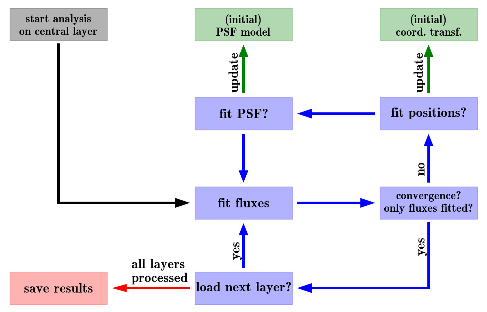

.. _routines:

Routines
========

The analysis with PampelMuse is divided into several stages, each of which is performed by a different routine. The
calling sequence for any of the routines is::

    PampelMuse <user-configration-file> <routine>

Details about the user configuration file that has to be provided with every call can be found
:ref:`here <user-configuration>`. The routines that are currently available are lsted below.

.. _ptsort:

PTSORT
------

.. _initfit:

INITFIT
-------

Description
^^^^^^^^^^^

This first step of the analysis chain serves two main purposes. First, to determine the location of the integral field
data relative to the reference catalogue. Second, to identify the subset of sources from the reference catalogue for
which it is feasible to extract spectra from the IFS data. As the reference catalogue ideally was obtained from higher
resolution data and typically covers a larger area on the sky, it would be impractical to try and extract a spectrum
for each star in the catalogue. Instead, `INITFIT` uses several criteria to make a selection.

To achieve these aims, the following steps are performed:

    #. Open the :ref:`integral field data <integral-field-data>`, checking their validity.

    #. Open the :ref:`reference catalogue file <reference-catalogue>`, checking its validity.

    #. Create an image from the integral field data in the photometric passband in which the magnitudes in the
       reference catalogue are provided.

    #. If world coordinates are available in the reference catalogue and the integral field data include
       :ref:`sufficient information <wcs-information>` for converting world to spaxel coordinates and vice versa,
       compute predicted spaxel coordinates for all sources in the reference catalogue.

    #. Create a mock image from the brightest sources in the reference catalogue, using the provided magnitudes as
       reference. If possible, i.e. if the previous step was carried out, the mock image is prepared using the same
       spatial sampling as the integral field data and the initial guess of the PSF provided in the user configuration
       file.

    #. Cross-correlate the two images just created to find the most likely location of the integral field data with
       respect to the reference catalogue. This step is skipped if the two images have different orientation or spatial
       sampling.

    #. If requested, load the :ref:`PampelMuse GUI <pampelmuse-gui>` with the content following content:

        * The *Reference view* shows the mock image created from the photometric input catalogue. The sources are
          marked with red circles and are pickable. When selecting a source via the left mouse button, some information
          about it is displayed in the status bar at the bottom of the GUI. If the cross correlation carried out
          during the previous step was successful, then the reference view also shows the suggested position and
          orientation of the integral field data.
        * The *IFS view* shows a layer from datacube (initially the central one). If the cross-correlation carried out
          during the previous step  was successful, then the GUI will show the suggested positions of the brighter
          sources as green circles. It is possible to grab individual spaxels from the cube using the left mouse
          button.
        * The *Spectrum viewer* is initially empty. If a spaxel is grabbed in the *IFS view*, then the spectrum of that
          spaxel is displayed.

    #. From here, there are basically two options on how to proceed:

        a. If the cross correlation was successful and you are happy with the location of the integral field data with
           respect to the reference catalogue, then you can just close the GUI and let `INITFIT` proceed with the
           source selection.
        b. If the cross correlation was skipped, failed, or you are not happy with its result, then you will have to
           define the approximate location of the integral field data with respect to the reference catalogue manually.
           To do so, proceed as follows. Pick a source from the *reference view* with the left mouse button, then
           select its approximate position in the *IFS view*, again using the left mouse button. Once a source is
           successfully identified, it will be displayed by a filled red circle in the *Reference view*. To undo the
           identification for a source, pick it with the *right* mouse button in the *Reference view*. At least three
           sources should be identified before closing the GUI. INITFIT will then use this information to (re)determine
           the location of the integral field data.

    #. Using the predicted spaxel coordinates, estimate the signal-to-noise ratio (S/N) for all sources from the
       reference catalogue. This also requires an estimate of the fluxes of the sources in the integral field data,
       i.e. the photometric zeropoint of the data must be predicted. This is done by calculating the sum of the fluxes
       of all sources from the reference catalogue that are inside the field of view and comparing it to the actual
       flux in the image created from the integral field data (cf. step 3). The photometric zeropoint is then chosen so
       that the two fluxes are in agreement. Depending on the size of the reference catalogue, this step may take some
       time, even though it is parallelized.

    #. The next step is the actual source selection. `INITFIT` will loop over the sources in the reference catalogue,
       sorted by magnitude, i.e. brightest first, and do a number of checks to determine the status of every source in
       the fitting process:

        a. Check if the local source density (given as the number of sources per resolution element, i.e per circle
           with radius equal to the full width at half maximum (:math:`\text{FWHM}`) of the PSF) of brighter sources is
           below a threshold value, that is given by the configuration key `initfit|confdens`. As for larger fields of
           view, e.g. in the analysis of MUSE data, the stellar density can be very different across their extents, the
           confusion limit is estimated locally in an area of radius :math:`10\times\text{FWHM}` around each star.
        b. Check if S/N is above the threshold value, defined by the configuration key `initfit|snrcut`. In the
           following two cases, the S/N determined in the previous step is modified:

            i. If a source is outside the IFS field of view, the S/N is penalized by :math:`\exp\{-(d/\text{FWHM})^2\}`,
               where :math:`d` is the distance to the nearest spaxel.
            ii. If a source is nearby a brighter source (with a distance :math:`r<\text{FWHM}`), the S/N is modified
                with the factor :math:`1.+0.9\log(r/\text{FWHM})`. This factor approximates the decrease in S/N found
                for nearby sources in [Kamann2013]_.

        c. Check that there is no brighter source in the direct vicinity, defined as a circle centred of the source
           with a radius given by the configuration key `initfit|binrad`, of the source.

       Sources that pass all three checks are assigned status :math:`2`. They are considered resolved and their spectra
       are set for extraction. Sources that fail the last criterion or the S/N criterion because of their vicinity to a
       brighter source are given status :math:`1` and their contribution is accounted for in the extraction of the
       spectrum of the brighter neighbour. All other stars are given status :math:`-1` and are ignored during the
       spectrum extraction.

    #. The next step is only carried out if an unresolved stellar component should be included in the extraction
       process. The idea here is that the sources that are fainter than the resolution limit still create a grainy
       structure across the field of view (similar to surface brightness fluctuations in nearby galaxies). If the
       reference catalogue is of sufficient depth, this graininess can be modelled using the broadband magnitudes,
       positions, and the PSF. In the extraction, a combined spectrum will be extracted for the entity of these
       sources. If such a component is used and which sources enter it is defined by the keys in the `unresolved`
       section of the configuration. All sources included in the unresolved component are given status :math:`0`.

    #. To account for the spectrum of the night sky or an unresolved stellar background, additional components may be
       included in the extraction. To this aim, the parameters of the `sky` section of the configuration can be used.
       The way background components are currently handled can be summarized as follows. A homogeneous grid is defined
       across the field of view, with a spatial sampling defined by the `sky|binsize` parameter. For each grid point,
       one additional component is included in the optimization. The weight of a spaxel in a grid point is obtained
       via inverse distance weighting, where distance is measured using a two-dimensional Gaussian with width
       :math:`0.5\times\texttt{binsize}` centred on the grid point. As a rule of thumb, in crowded fields with a
       significant number of unresolved sources, `binsize` should be of the order of the spatial scale over which the
       stellar density changes significantly (e.g., the core radius of a star cluster).

       .. As an example, Fig.~\ref{fig:residuals_skysize} compares the residuals of the extraction for a MUSE cube of
          NGC 6266 when using a constant or a variable sky. It is clear that the constant sky cannot account for the
          strong increase in stellar density towards the cluster centre. For this reason, the stars leave systematic
          positive residuals in the outskirts (where the sky is overestimated) and negative residuals in the centre
          (where the sky is underestimated).

    #. The next step depends on the size of the IFS data, more precisely on the number of spaxels. PampelMuse was
       designed to handle data coming from various instruments, such as PMAS and MUSE. Now, PMAS has
       :math:`256\,\text{spaxels}` while MUSE has more than :math:`90\,000`. As a consequence, the way the PSF is
       optimized for the two instruments is different. Within a field of view as small as the one of PMAS, you will
       almost never find reasonably isolated and bright stars that allow you to constrain the PSF. Instead, for
       PMAS-like data the idea is to optimize the PSF profile in a simultaneous fit to all resolved sources. While this
       approach works well for the :math:`\sim20` sources which can typically be resolved in a PMAS cube, it is
       computationally very demanding for the :math:`\sim5\,000` sources one expects to resolve in a MUSE cube.
       However, for MUSE data the chances of finding good PSF stars are much higher. To account for this  diversity in
       input data, PampelMuse uses the configuration key `global|smallifu`. My recommendation is to set this parameter
       to :math:`\text{True}` for cubes with less than :math:`\sim2\,000\,\text{spaxels}` and to :math:`\text{False}`
       otherwise. In the latter case, `INITFIT` will search for suitable sources to model the PSF during the
       extraction. Accepted PSF sources are those that fulfil the following criteria:

        a. They must be brighter than the limit set by the configuration parameter `initfit|psfmag`.
        b. They must have been identified as resolved (i.e. status :math:`2`) in the source selection process.
        c. They mus have a distance :math:`\geq \text{FWHM}` from the edge of the observed field of view.
        d. The relative contribution from neighbouring sources :ref:`inside the region where the PSF is modelled
           <psf-radius>` must be smaller than a threshold value given by the configuration parameter
           `initfit|apernois`.
        e. There are no brighter sources are allowed within a distance equal to :math:`1.5\times` the PSF definition
           radius.

       Aperture photometry is performed on each layer for each source that fulfils the above criteria. The aperture
       radius can be set in the configuration file. Afterwards, the centroids of the aperture photometry are used to
       estimate the source coordinates as a function of wavelength. In addition, the second order moments measured for
       the PSF sources are used to estimate the ellipticity and the position angle of the PSF (if they are free
       parameters :ref:`in the PSF fit <psf-fitting>`).

    #. Write the results from the source selection to the dedicated multi-extension :ref:`PRM-file <output-prm>`, which
       is loaded by all other routines of PampelMuse.

.. _initfit-config:

Relevant configuration parameters
^^^^^^^^^^^^^^^^^^^^^^^^^^^^^^^^^

.. If instead a fixed photometric zeropoint should be used (not recommended!), the key \emph{zeromag} of the
   \emph{initfit} section may be used.

initfit|zeromag : float
    Initial guess for the photometric zeropoint of the integral field data in the provided passband, i.e. the magnitude
    of a source creating :math:`1\,\text{count}/\text{layer}`.

initfit|zerofix : boolean
    Flag indicating if the provided initial guess for the photometric zeropoint of the integral field data should be
    updated based on a comparison between the measured total flux in the data and the expected total flux given the
    magnitudes of the sources in the reference catalogue. Using a fixed zeropoint can be useful if the flux in the data
    is not dominated by the contributions of the sources listed in the reference catalogue but by the background.

initfit|confdens : float
    The confusion density, i.e. the maximum density of resolvable sources per resolution element. The local resolution
    limit will be the magnitude at which the density of brighter sources reaches this density. The default value of
    :math:`0.4` was determined using simulations [Kamann2013]_.

initfit|snrcut : float
    The minimum estimated signal-to-noise ratio of sources that are included in the extraction.

initfit|binrad : float
    The minimum spatial distance to a brighter source (in units of the PSF :math:`\text{FWHM}`) of a source that is
    considered resolvable.

unresolved|use : boolean
    If True, the routine will collect all sources inside the field of view that are less than a given number of
    magnitudes fainter than the faintest resolved source and extract a combined spectrum for them.

unresolved|binsize : float
    The width of the magnitude interval of the unresolved component, in the sense that the faintest sources included in
    the unresolved component are `binsize` magnitudes fainter than the faintest resolved sources.

sky|use : boolean
    If True, one or more non-stellar components are included in the fit to account for background sources.

sky|binsize : float
    The distance between two background patches. If set to :math:`-1`, only a constant background is used.

initfit|psfmag : float
    The maximum magnitude of sources considered as suitable for modelling the PSF. If not given (default), the limit
    is :math:`3` magnitudes brighter than the faintest resolved source.

initfit|apernois : float
    The maximum allowed contamination around a PSF source from a neighbouring source. It is measured as the flux ratio
    of the brightest source within the PSF definition radius and the flux of the considered source itself.}

initfit|aperrad : float
    The radius in spaxels of the circle around each PSF source in which the aperture photometry is performed.

.. _singlesrc:

SINGLESRC
---------

.. _cubefit:

CUBEFIT
-------

Description
^^^^^^^^^^^

This routine performs the extraction of the spectra by simultaneously fitting a PSF to all sources that have been
identified as resolvable by the :ref:`INITFIT routine <initfit>`. CUBEFIT analyses the integral field data layer by
layer, starting from the central layer and alternatingly proceeding into the red and the blue parts of the cube. On
each layer, the code performs an iterative analysis in order to extract the optimal flux for each source. This
iterative scheme, also depicted in :ref:`the figure below <figure-cubefit-scheme>`, can be summarized as follows.

    #. Using the initial guesses for the PSF and the coordinate transformation, a first fit of the fluxes is performed.
       The flux fit is a linear least-squares fit that can be solved by direct matrix inversion and does not require
       initial guesses. The matrix contains the PSF profiles of the individual components, one per column. As each PSF
       profile is significantly different from zero only in the vicinity of the represented star, the majority of the
       matrix entries are zero. For such sparse matrices very efficient inversion algorithms are available. `CUBEFIT`
       uses the method `lsmr
       <https://docs.scipy.org/doc/scipy/reference/generated/scipy.sparse.linalg.lsmr.html#scipy.sparse.linalg.lsmr>`_
       developed by [Fong2010]_, which is available in the `scipy.sparse.linalg
       <https://docs.scipy.org/doc/scipy/reference/sparse.linalg.html>`_ package. The performance was tested for up to
       :math:`10\,000` sources, yielding reliable solutions in reasonable computation times.
    #. With an initial value for all fluxes available, the spaxel coordinates and/or the PSF are optimized (if
       requested). The way in which this is done depends on the analysis setup, in particular on the value of the
       `global|smallifu` parameter and whether :ref:`INITFIT <initfit>` or :ref:`SINGLESRC <singlesrc>` has been used
       to initialize the analysis.

        a. If `INITFIT` has been used and the `global|smallifu` parameter is enabled, the optimization is carried out
           using the whole layer, i.e. a model is created containing all resolvable sources and the :math:`\chi^2`
           between this model and the layer is minimized. The optimization is performed for the parameters of the
           coordinate transformation first, and afterwards for the PSF parameters.
        b. If `INITFIT` has been used and the `global|smallifu` parameter is disabled, `CUBEFIT` will perform a series
           of single-PSF fits. For each source deemed suitable, the relevant part of the layer is selected and adjacent
           sources are subtracted based on the current best-fit model. Afterwards, a single PSF model is fitted to the
           data and optimized for the flux, the centroid positions, and all free PSF parameters. Once all sources have
           been processed in this way, the new coordinate transformation is obtained by comparing the reference
           coordinates to the fitted centroids. In addition, the new PSF model is obtained by averaging the parameters
           obtained in the successful fits.
        c. If `SINGLESRC` has been used, the process is very similar to option b., only that the centroids are used
           directly, given that no coordinate transformation is available.

       The non-linear optimizations required to perform the steps just described are performed via the
       Levenberg-Marquardt algorithm `scipy.optimize.least
       <https://docs.scipy.org/doc/scipy/reference/generated/scipy.optimize.leastsq.html>`_. To speed up the
       computation, `CUBEFIT` internally calculates the Jacobi matrix, i.e. the matrix containing the partial
       derivatives of the PSF profile(s) with respect to the fitted parameters.
    #. The updated PSF and coordinate transformation are used to refit the fluxes of the sources. Afterwards, it is
       checked whether the fluxes converged. The convergence criterion that is used by PampelMuse is that the median
       change in flux compared to the last iteration is :math:`<0.005`. If the convergence criterion is fulfilled or
       the maximum number of iterations has been reached, the analysis is continued with the next layer. Otherwise,
       the iteration continues with fitting the coordinate transformation and/or PSF parameters (step 2). The maximum
       number of iterations can be set using the configuration key `cubefit|iterations`.
    #. After all the requested layers have been analysed in this way, the results are written to the :ref:`PRM-file
       <output-prm>`.

    The iterative fitting approach of the `CUBEFIT` routine.

After the first two layers have been processed, the code will use the fit results for the PSF and the coordinate
transformation as initial guesses for the analysis of the next layer. To avoid that a failed fit in one layer (e.g.
because of a strong cosmic-ray) influences the analysis of the following ones, the initial guesses are obtained by
averaging over the results from the :math:`10` adjacent layers.

.. note::
    This routine is computationally the most demanding part of PampelMuse. The executions times can vary from a few
    minutes if only some sources are present to tens of hours for really crowded fields and huge datasets. My
    recommendation is to start `CUBEFIT` in a `screen` session, detach from it and have a good glass of wine.
    (Note however that for budget reasons, the wine is not shipped with PampelMuse)

.. versionadded:: 1.0
    In cases where the astrometric accuracy of the reference catalogue is limited (e.g., because proper motions have
    offset the sources with respect to their reference coordinates), `CUBEFIT` offers the possibility to determine the
    shifts between the predicted and the actual coordinates of the sources. To this aim, the configuration parameter
    `cubefit|offsets` must be enabled. In this case, `CUBEFIT` will perform individual PSF fits for all resolved
    sources (in a very similar manner to the one described above in step 2b for the PSF sources, only that no PSF
    parameters are fitted) in order to determine their true centroid positions. The offsets with respect to their
    predicted centroid positions are applied in subsequent fits to the source fluxes. Averaged offsets across the
    wavelength range are also written to the :ref:`PRM-file <output-prm>` and used in all subsequent analysis steps.

.. _cubefit-parameters:

Relevant configuration parameters
^^^^^^^^^^^^^^^^^^^^^^^^^^^^^^^^^

cubefit|iterations : integer
    The maximum number of iterations that is performed by `CUBEFIT` on an individual layer of the IFS data.

cubefit|offsets : boolean
    In order to determine and correct for offsets between the source coordinates provided in the reference catalogue
    and the actual coordinates, this parameter must be enabled.

.. _polyfit:

POLYFIT
-------

Description
^^^^^^^^^^^

The `POLYFIT` routine serves two purposes. First, it allows the user to visually check the results of the analysis, by
displaying the spectra extracted for individual sources or inspecting the wavelength dependencies of the spaxel
coordinates or PSF parameters. Second, it provides the functionality to fit polynomial functions to the aforementioned
coordinates and parameters. The idea behind the latter is that, from a theoretical point of view, you expect those
properties to vary smoothly with wavelength, e.g. because of differential atmospheric refraction (DAR). However,
because of the limited S/N in each layer, the values determined by :ref:`CUBEFIT <cubefit>` as a function of wavelength
will show scatter, especially in spectral regions were the signal is low, such as in telluric absorption bands. Fitting
those variations with polynomials averages out the scatter and should therefore lead to a higher S/N in the extracted
spectra. When starting `CUBEFIT` again after performing the polynomial fits, it will only refit the fluxes in each
layer while keeping the other parameters fixed at their polynomial values.

When running PampelMuse in interactive mode, the routine will load the :ref:`PampelMuse GUI <pampelmuse-gui>`, which
gives the user a number of options to work with the data:

    * The purpose of the *Spectrum Viewer* is to display extracted spectra or the wavelength dependencies of the fitted
      spaxel coordinates or PSF parameters. The data to be shown can be selected using the two drop-down menus labelled
      `Data:` to the bottom left of the panel. Via *HDU*, one can select the parameter class (spectrum, coordinate,
      PSF parameter) to be displayed, while *Identifier* lets one select a specific source ID in case a spectrum or
      spaxel coordinates should be displayed, or the specific parameter in case a PSF or coordinate transformation
      parameters should be displayed. The requested data is displayed upon clicking the green button.
    * Further, one can use the *Spectrum Viewer* to exclude wavelength ranges from the polynomial fits. To this aim,
      keep the *left* mouse button pressed while scanning over the desired range. Doing the same with the *right* mouse
      button lets you unmask regions again. If any wavelength ranges should be excluded from the fits by default (e.g.
      because of strong telluric absorption bands), you may specify these ranges using the configuration key
      `polynom|mask`. This key is also very helpful if `POLYFIT` is run in non-interactive mode (see below).
    * The two drop-down menus labelled `Fit:` to the bottom right of the *Spectrum Viewer* allow one to specify the
      type and degree of the polynomial that is used to fit the data. The default values can be set using the
      configuration keys `polynom|type` and `polynom|degree`. The fit is carried out via a click on the green button to
      the right of the drop-down menus. Note that currently only fits to the PSF parameters and the spaxel coordinates
      are supported. Fitting the individual spaxel coordinates instead of the coordinate transformation parameters
      (which were used to calculate them) is preferred because the parameters of the coordinate transformation can
      sometimes show correlated variations (in particular if the field of view contains only a few spaxels) that are
      difficult to correctly describe with polynomials.
    * The *IFS View* displays again the cube, with the positions of the extracted sources overplotted. The size of the
      circles used to indicate the locations of the sources scale with their brightnesses. Sources marked by green
      circles are used to fit the PSF. The source that is currently displayed in the *Spectrum View* is highlighted via
      a filled circle. When picking a source while the *Spectrum View* shows a spectrum or a spaxel coordinate, the
      spectrum/coordinate of the picked source will be shown. Depending on the number of sources included in the
      analysis, the plot can look very messy. However, you can use the standard matplotlib navigation bar located to
      the top right to zoom into the data or pan across it. Furthermore, you can restrict the magnitude range or the
      status of the sources that are displayed using the functionalities to the left of the *IFS View*.
    * The *Reference View* is currently not used.

After one has fitted all the desired parameters and is happy with the results, one can use the buttons to the top left
of the GUI to save the results to the :ref:`PRM-file <output-prm>`.

.. note::
    When PampelMuse is not run in interactive mode (controlled by the configuration key `global|interact`), `POLYFIT`
    will not show the GUI but use polynomials of the requested order to fit the source coordinates and the free PSF
    parameters automatically. The type and order of the polynomials being used as well as the wavelength ranges that
    should be masked can still be controlled via the respective configuration keys (see below).

Relevant configuration parameters
^^^^^^^^^^^^^^^^^^^^^^^^^^^^^^^^^

polynom|mask : tuple
    In case any wavelength range(s) should be excluded from the polynomial fits by default, provide their start and end
    values. The values must be provided as a single tuple of even length, so that even indices contain the start values
    and odd indices the end values of the ranges to be masked.

polynom|type : string
    The type of polynomial used to fit the wavelength dependencies. Can be one of `plain` (normal polynomial),
    `chebyshev`, `legendre`, and `hermite`.

polynom|degree : integer
    The degree of the polynomials used to fit the wavelength dependencies.

.. _subtres:

SUBTRES
-------

Description
^^^^^^^^^^^

PampelMuse also offers the possibility to create a residuals cube once the analysis is complete. To this aim, the
routine `SUBTRES` can be used. By default, it will subtract the contribution of all resolved stellar sources from the
data cube. However, it is also possible to subtract a subset of the resolved sources, using either of the
`subtres|include` or the `subtres|exclude` configuration keys. Only one of the keys should be set at a time.

In addition, `SUBTRES` allows the user to subtract the sky background and/or the background created by an unresolved
stellar component (if either of the components has been used in the analysis). To this aim, a key `subtract` exists in
both the `sky` and `unresolved` sections of the configuration.

Relevant configuration parameters
^^^^^^^^^^^^^^^^^^^^^^^^^^^^^^^^^

subtres|include : tuple
    The list of IDs of resolved sources that should be subtracted from the IFS data using `SUBTRES`. The default is to
    subtract all resolved sources unless the option `subtres|exclude` is used instead.

subtres|exclude : tuple
    The list of IDs of resolved sources that should *NOT* be subtracted from the IFS data using `SUBTRES`. By default,
    all sources are subtracted unless the sources to subtract are specified using the `subtres|include` option instead.

sky|subtract : boolean
    Flag indicating if the sky background should be removed when running the `SUBTRES` routine.

unresolved|subtract : boolean
    Flag indicating if the unresolved stellar background should be removed when running the `SUBTRES` routine.

.. _getspectra:

GETSPECTRA
----------

Description
^^^^^^^^^^^

Once the analysis is complete, one probably wants to obtain the spectra in some other format than the
:ref:`PRM-file <output-prm>`. To facilitate this, PampelMuse includes the routine `GETSPECTRA` It will store all the
extracted spectra as individual FITS files that contain the spectrum in the primary extension and an estimate of the
uncertainties in an image HDU named `SIGMA`. The header of each file will contain the correct dispersion information,
general information about the star and the spectrum as well as a number of `HIERARCH` keywords copied from the
PRM-file.

This routine requires the configuration key getspectra|prefix to be set in the :ref:`user configuration file
<user-configuration>`. This is a string (typically the name of the observed cluster, galaxy, ...) that is used as
a common prefix to all FITS files that are written. Additionally, the key `getspectra|folder` in the same section can
be used to provide a folder in which all spectra should be stored.

Relevant configuration parameters
^^^^^^^^^^^^^^^^^^^^^^^^^^^^^^^^^

getspectra|prefix : string
    The common prefix given to all FITS files that are written.

getspectra|folder : string
    The name of the folder in which the FITS files should be stored.
